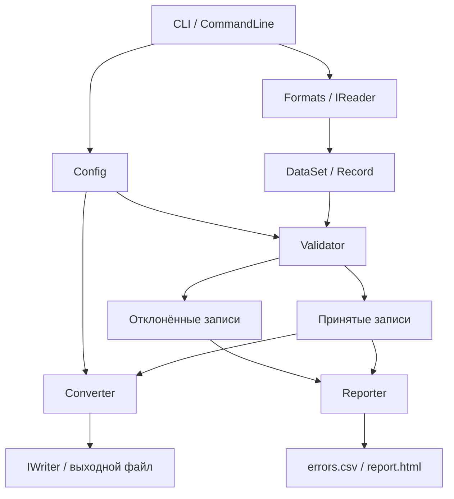

# Архитектура DataBridge

## Схема модулей

Текстовая схема: CLI → выбор Reader → DataSet → Validator → корректные записи → Converter → Writer. Validator также передаёт ошибки Reporter, который формирует CSV и HTML. При stats CLI использует только Reader и DataSet.

## Модули

| Каталог | Компоненты | Ответственность |
|---|---|---|
| readers | IReader, IWriter, Formats, CsvFormat, JsonFormat, XmlFormat, ExcelFormat | Выбор адаптера и ввод/вывод |
| validators | IValidator, Validator, ValidationResult | Правила, нормализация, разбиение записей |
| converters | IConverter, Converter | Трансформации по порядку, затем маппинг |
| reporters | IReporter, Reporter | HTML и CSV ошибок |
| cli | CommandLine | Параметры, оркестрация, коды завершения |
| Models.cs | Record, DataSet, Config, FieldRule, Scalar | Единая модель и типизация |

Все адаптеры реализуют общий контракт. Новый формат требует реализации IReader/IWriter и регистрации в Formats; валидатор и отчётность не зависят от формата. XLSX использует ZIP и XML (Office Open XML), без Excel COM и внешних пакетов.

Валидация: тип проверяется прежде зависимых правил, диапазоны включают границы. Сначала проверяются все правила записи, затем успешная запись резервирует уникальные значения. При convert дополнительно проверяются трансформации; при ошибке преобразования отклоняется конкретная строка. Исходные значения сохраняются в errors.csv. Одинаковые выходные имена полей — ошибка конфигурации. HTML экранирует данные.

Для больших файлов: заменить DataSet потоковым IEnumerable/IAsyncEnumerable, использовать последовательные читатели и писатели, хранить множество уникальных ключей в памяти или на диске, отдельно собирать счётчики и потоковый отчёт. Текущий вариант загружает набор целиком.
